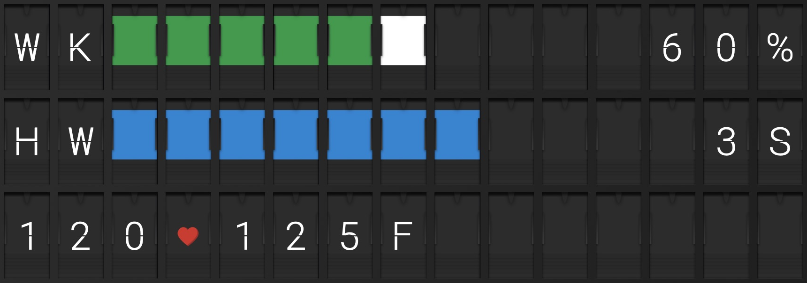
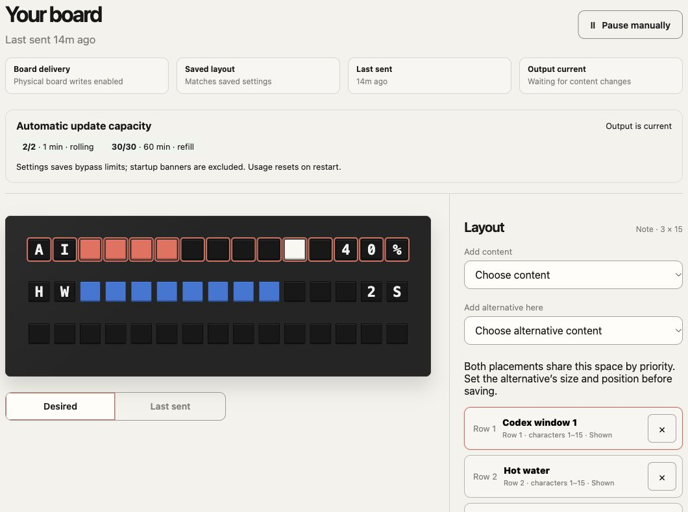
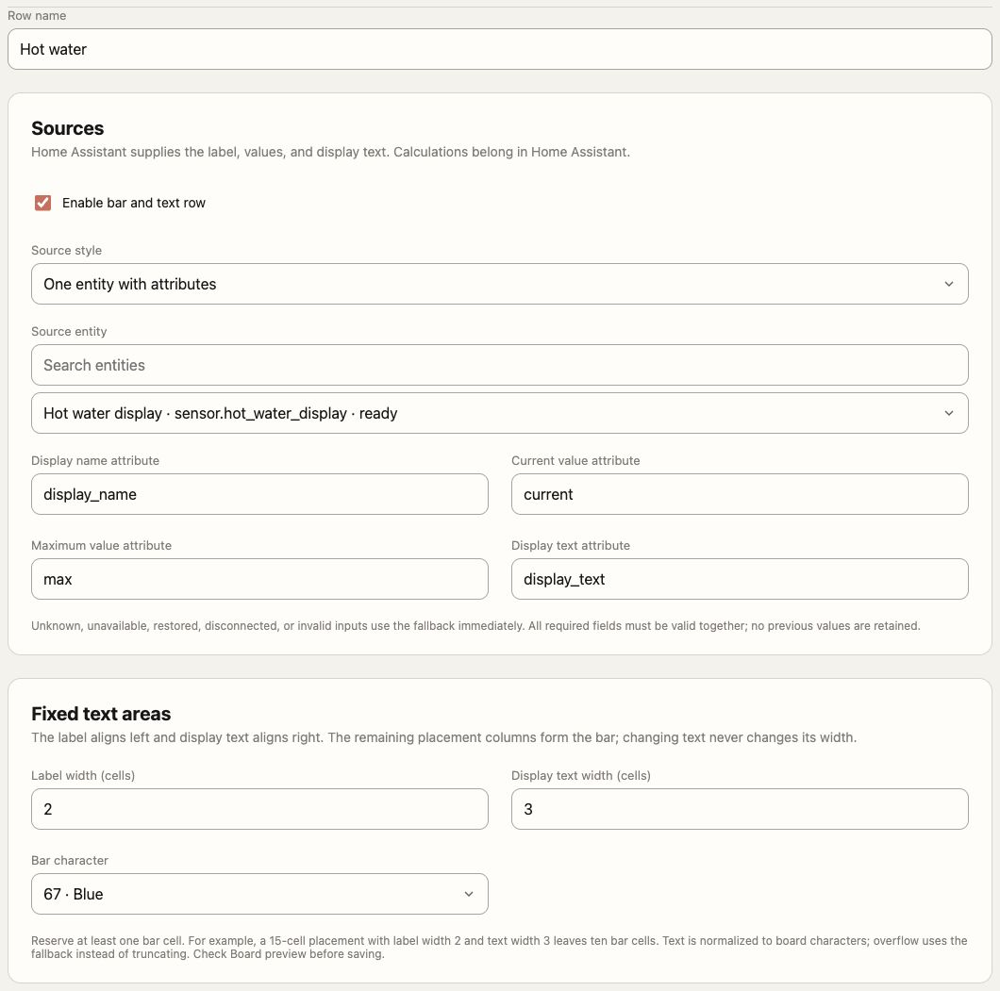
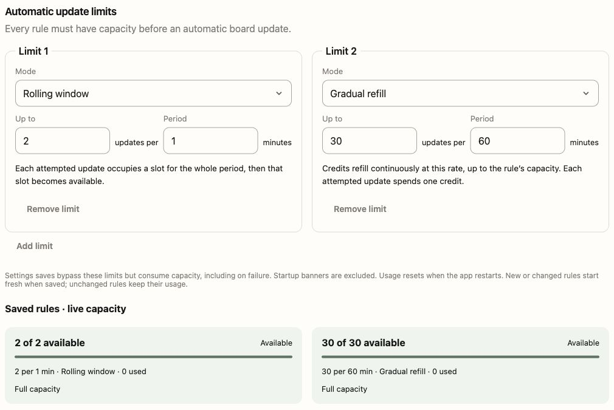
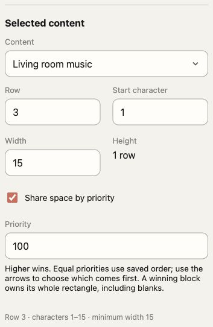
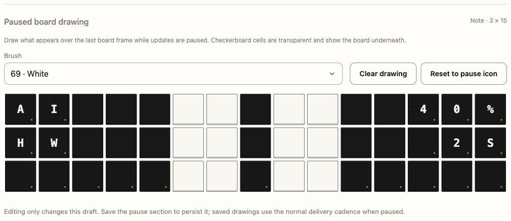
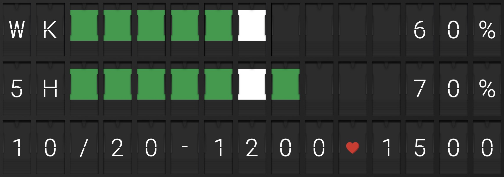
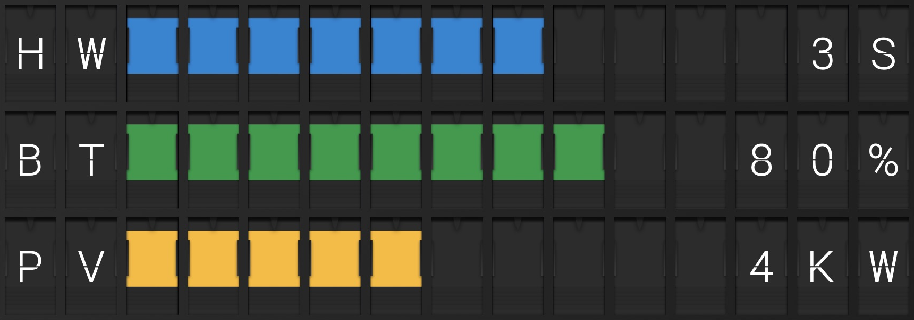
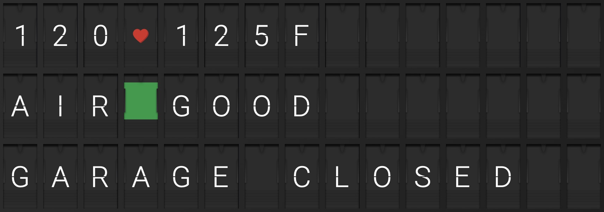

# [Vestaboard](https://web.vestaboard.com/referral?vbref=NZJHOT) Multiplexer

vbmux is a small service and web interface for arranging Home Assistant and Codex content on a [Vestaboard](https://web.vestaboard.com/referral?vbref=NZJHOT) (referral link). It supports Note (3 × 15) and Flagship (6 × 22), with a live board preview and configurable update limits.



## Features

- **Local or Cloud API:** Send content directly to your Vestaboard over the local network or through Vestaboard’s cloud.
- **Home Assistant integration:** Build bar and text rows from entity states and attributes, or let Home Assistant supply character-code arrays for custom displays.
- **Codex quota integration:** Display usage limits, reset timing, and quota pacing alongside your Home Assistant content.
- **Flexible layouts:** Preview and arrange content on Note or Flagship, with shared-space priorities and configurable automatic update limits.

## Install (Docker recommended)

Docker Compose is the recommended way to run vbmux.

```sh
git clone https://github.com/jiehanzheng/vestaboard-multiplexer.git
cd vestaboard-multiplexer
cp .env.example .env
docker compose up --build
```

Open `http://<server-host>:3000`, replacing `<server-host>` with the hostname or IP address of the computer running Docker. Use `http://localhost:3000` only when browsing on that same computer. To change the published port, set `VBMUX_PORT` in `.env` before starting Compose and use that port in the URL. If you use a reverse proxy, open its configured URL instead. The web interface has no application login; keep it on a trusted network or protect access through your reverse proxy.

Compose keeps application settings in the `vbmux-data` volume. It mounts `${HOME}/.codex` for Codex credentials; set `CODEX_HOST_DIR` in `.env` if they live elsewhere.

See [docker-compose.yml](docker-compose.yml) for the Compose configuration.

## Connect your Vestaboard

Open **Settings → Board output**. Choose **Auto detect**, **Note**, or **Flagship**, then configure one of the supported connections:

| Connection | Setup |
| --- | --- |
| **Local API** | Follow [Vestaboard’s Local API setup](https://docs.vestaboard.com/docs/local-api/authentication/) to request an enablement token and exchange it for the board’s API key. Enter the returned key in **Local API key**, not the enablement token. Set **Local API URL** to the board’s message endpoint (default `http://vestaboard.local:7000/local-api/message`). |
| **Cloud API** | Create a board-specific token in the API tab on [Vestaboard’s web app](https://web.vestaboard.com/) or the mobile app’s **Settings → Advanced Settings**, following the [Cloud API instructions](https://docs.vestaboard.com/docs/read-write-api/authentication/). Enable **Write** permission for delivery and **Read** for automatic board detection. Enter it in **Cloud token** and keep **Cloud API URL** at `https://cloud.vestaboard.com/`. |

Choose **Save board settings**.

Then configure content under **Plugins**, arrange it on **Board**, and choose **Apply layout**. Board shows the preview, delivery status, and connection errors. For Codex content, open **Plugins → Codex** to check the mounted account or start device sign-in.

## Web interface

| Screenshot | Description |
| --- | --- |
|  | Preview your board, arrange content, and see live update capacity. |
|  | Bind HA attributes and configure fixed label, bar, and text areas. |
|  | Combine rolling-window and gradual-refill limits with live capacity counters. |
|  | Set placement and priority for content that shares board space. |
|  | Draw a pause overlay with transparent cells over the current board. |

## Home Assistant

In Home Assistant, open **User profile → Security → Long-lived access tokens → Create token** ([token documentation](https://developers.home-assistant.io/docs/auth_api/#long-lived-access-token)). In vbmux, open **Settings → Home Assistant**, enter **Home Assistant URL** and **Long-lived access token**, then choose **Test connection** and **Save Home Assistant**. Use a URL reachable from the vbmux container; `localhost` inside the container refers to the container itself.

Add entity-backed content under **Plugins → Bar and text rows** or **HA character blocks**. Home Assistant supplies values and formatting; vbmux composes the resulting content on your board.

## Plugins

These examples use synthetic data rendered by the current plugins and captured from the official Vestaboard website in Safari.

### Codex

Show up to two quota windows with remaining percentages, reset times, and optional pacing colors that compare quota remaining with time remaining. Configure window labels and device sign-in under **Plugins → Codex**; optional auto-start can start a reset window when a watched quota is full.



The bottom row shows the weekly reset date and time, then a heart separator and the five-hour reset time: `10/20-1200♥1500` means October 20 at 12:00 and 15:00, respectively, in the configured time zone.

### Bar and text rows

Combine a label, colored bar, and right-aligned text in fixed-width areas. Bind all values to attributes of one Home Assistant entity, or choose constants and entity states or attributes separately for each field. Home Assistant owns calculations such as remaining showers; vbmux renders the supplied values. Each row has its own color, widths, placement, and unavailable fallback.



To reproduce these rows, expose the following entity states and attributes in HA (example entity data, not `configuration.yaml`):

| Entity | State | `display_name` | `current` | `max` | `display_text` | Bar character |
| --- | --- | --- | --- | --- | --- | --- |
| `sensor.water_display` | `ready` | `HW` | 61.5 | 100 | `3S` | 67 (blue) |
| `sensor.battery_display` | `ready` | `BT` | 80 | 100 | `80%` | 66 (green) |
| `sensor.solar_display` | `ready` | `PV` | 42 | 100 | `4KW` | 65 (yellow) |

Create three rows using **One entity with attributes** and select the corresponding entity. Map **Display name**, **Current value**, **Maximum value**, and **Display text** to `display_name`, `current`, `max`, and `display_text`. Use label width **2**, text width **3**, placement width **15**, and the bar character above; place the rows top to bottom. The remaining ten cells form the bar: these values fill seven, eight, and five cells, respectively.


### HA character blocks

Let Home Assistant supply a flat array of Vestaboard character codes in an attribute of an entity whose state is `ready`. Use independent rectangular blocks for custom symbols, temperature displays, air quality, or status messages. Optionally append text from the same or another entity, or use a boolean activity attribute to yield space when inactive. Configure block size, placement, priority, and blank or `N/A` fallback in **Plugins → HA character blocks**.



Here HA supplies the temperature characters and heart, an `AIR` label with a green tile and appended `GOOD` text, and a garage status message. These are example HA inputs, not built-in temperature or air-quality calculations.

Expose these HA entities with state `ready` and the listed attributes:

| Entity | `characters` attribute | `display_text` attribute | Rendered content |
| --- | --- | --- | --- |
| `sensor.temperature_display` | `[27, 28, 36, 62, 27, 28, 31, 6]` | — | `120♥125F` |
| `sensor.air_display` | `[1, 9, 18, 66]` | `GOOD` | `AIR` + green tile + `GOOD` |
| `sensor.garage_display` | `[7, 1, 18, 1, 7, 5, 0, 3, 12, 15, 19, 5, 4]` | — | `GARAGE CLOSED` |

Create one block per entity, set **Character attribute** to `characters`, and use width **15** and height **1**. For the air block, set **Append text attribute** to `display_text` with the same entity as its text source; leave it empty for the other blocks. Leave **Activity attribute** empty and place the blocks top to bottom. Unused cells are padded with blanks. Code `62` is the heart, `66` is green, and `0` is a blank.
